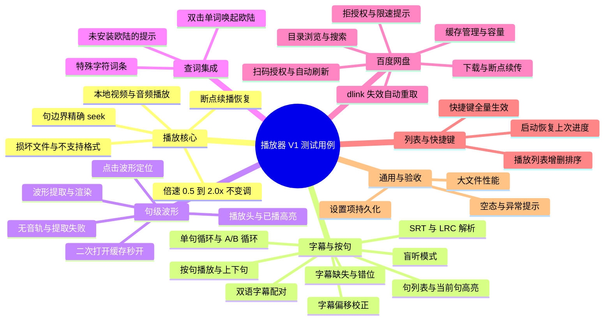

# 英语视频学习播放器（macOS）技术方案 V1.0

# 摘要

本文档回答三个问题：技术栈选什么、系统如何分层、核心模块怎么实现，并在最后给出风险与里程碑。方案建立在已确认的需求文档 V1.0 之上，所有模块与 UI 设计稿一一对应，保证从设计到实现的零偏差。

  - **技术栈**：macOS 原生 Swift + SwiftUI + AVFoundation，目标系统 macOS 14+；不做跨端框架，通过 MediaCore 协议预留跨端边界。
  - **架构**：四层结构——界面层、应用服务层、媒体核心层、基础设施；业务不直接触碰媒体，未来替换播放实现不影响上层。
  - **关键集成**：查词走欧陆词典 URL scheme（eudic://dict/单词）；百度网盘 V1 采用开放平台 OAuth 设备码授权 + xpan API + dlink 下载缓存播放。
  - **主要风险**：网盘限速与 dlink 时效、字幕时间轴偏差、波形提取性能；均有对策，见"关键风险与对策"。
# 技术选型与决策依据

选型遵循已确认的原则：先 macOS 原生，不引入跨端框架，避免技术历史债务；长期跨端靠播放核心抽象实现，见"总体架构"。

| 维度 | 选型 | 理由与取舍 |
|---|---|---|
| 技术栈 | Swift + SwiftUI + Swift Concurrency | 与设计稿零偏差；macOS 14+ 全特性可用；不引入跨端框架，避免抽象层折损原生体验 |
| 视频播放 | AVPlayer（AVFoundation） | 系统级硬件加速，内置倍速与音质算法、时间回调；不选自定义解码（ffmpeg），V1 无格式扩展需求 |
| 音频录制（V2 预留） | AVAudioEngine | 系统录音管线，后续跟读对比直接复用波形提取链路 |
| 波形提取 | AVAssetReader + Accelerate vDSP | 读取 PCM 采样，vDSP 计算峰值包络，性能可控、可离线缓存 |
| 持久化 | SQLite + Keychain | SQLite 存结构化进度与缓存索引；网盘 Token 等凭据进 Keychain，不落盘明文 |
| 字幕解析 | 自研轻量 SRT / LRC 解析器 | 格式简单，无第三方依赖，便于支持双语配对与偏移校正 |
| 网盘集成 | 百度网盘开放平台（OAuth 设备码 + xpan API） | 官方能力，支持扫码授权与文件下载；详见"百度网盘"模块 |
| 查词 | 欧陆词典 URL scheme（eudic://dict/单词） | 不内置词典、不用系统词典（用户决策），安装欧陆词典即可用 |
| 依赖管理 | Swift Package Manager | 系统自带，工程干净 |

# 总体架构

四层职责与关键数据流如下：

> [HTML 交互图] 英语视频学习播放器总体架构：UI层、应用服务层、媒体核心层、基础设施四层，含关键数据流与跨端预留边界（用浏览器打开 docs/widgets/ 下对应文件查看）

分层原则：界面层只消费应用服务层的可观察状态；应用服务层通过 MediaCore 协议下发播放指令，不感知 AVFoundation 细节；媒体核心层是跨端预留边界，未来 Windows / Linux / 移动端只需提供协议实现。波形、网盘、查词均为独立服务，互不耦合。

# 核心模块方案

## 播放引擎与按句播放

播放使用 AVPlayer 承载本地与网盘缓存文件。倍速通过 player.rate 实现，并将 audioTimePitchAlgorithm 设为 .timeDomain（或 .spectral），保证 0.5–2.0x 不变调；句边界跳转使用 seek(to:toleranceBefore:toleranceAfter:)，传 CMTime.zero 容差实现精确对齐。按句播放由 SentenceEngine 驱动：维护当前句索引与播放状态机（就绪→播放→暂停→完成），句尾到达后按用户选择的模式执行下一句、暂停或单句循环；A-B 循环记录两个时间点，在时间回调中判断越界回跳。

## 字幕系统

SubtitleEngine 负责解析与对齐：SRT 用于视频场景，LRC 用于音频场景，两种格式统一归一化为句模型（id、开始时间、结束时间、英文文本、中文翻译）。双语字幕通过同名中文文件（如 xxx.en.srt 与 xxx.zh.srt）或单文件内分段自动配对，配对失败时允许手动指定。偏移校正提供 ±N 秒的整体平移并持久化到媒体项，解决字幕与音轨不同步问题。盲听模式仅隐藏字幕文本，不中断播放。句模型为波形与按句播放提供统一时间基准。

## 句级波形

波形是 V1 的重点功能，为 V2 录音对比打基础：

  **提取**：打开媒体后由 WaveformService 在后台线程用 AVAssetReader 读取音频轨 PCM，vDSP 计算峰值包络并按句时间窗切分，生成每句的波形数据。
  **缓存**：波形数据按媒体与句索引落盘缓存，二次打开直接复用，避免重复计算。
  **显示与定位**：SwiftUI Canvas 绘制对称波形与播放头；点击波形按比例 seek 到句内位置，并同步高亮已播放部分。
  **V2 预留**：Recorder 模块使用 AVAudioEngine 录制用户跟读，复用同一提取链路生成对比波形，上下对齐展示；V1 只预留数据接口与 UI 占位。
## 查词（欧陆词典）

DictionaryService 只做一件事：把选中文本交给系统唤起欧陆词典。实现为 NSWorkspace.shared.open(URL(string: "eudic://dict/单词"))，查词入口挂在字幕右键菜单与双击选中词上。唤起前用 canOpenURL 检测 eudic scheme 是否可用，未安装时提示用户安装欧陆词典。不内置词库、不调用系统词典，保持轻量并完全尊重用户本地词库配置。

## 百度网盘（V1 下载缓存播放）

按需求文档锁定方案 B：V1 只做下载缓存后本地播放，在线流式播放留到后续迭代。实现链路如下：

  **授权**：OAuth 2.0 设备码模式，应用内展示二维码，用户手机扫码授权；access_token 有效期 30 天、refresh_token 长期有效，均存入 Keychain，过期自动刷新。
  **浏览与搜索**：xpan API（pan.baidu.com/rest/2.0/xpan/file），list 列目录、search 按文件名搜索。
  **获取下载链接**：filemetas 接口请求 dlink=1，返回下载地址（约 8 小时有效）。
  **下载**：URLSession 下载并支持 Range 断点续传；进度写入 CacheManager，中断后可续传。
  **播放**：下载完成后按本地文件播放；缓存记录支持查看、删除与容量清理。

提示与约束：非会员下载存在限速，属平台策略，产品上做预期管理；dlink 失效时自动重新获取后续传。V2 迭代方向为在线流式播放与更深的网盘目录能力。

## 播放列表、断点续播与快捷键

LibraryService 管理媒体项与播放列表：本地文件扫描导入，网盘下载项自动入库；每个媒体项记录播放位置，启动时自动恢复上次媒体与进度。快捷键通过 SwiftUI 菜单命令与 keyboardShortcut 实现：Space 播放/暂停、←/→ 上一句/下一句、1–5 切换倍速、S 隐藏字幕（盲听）、L 单句循环开关，与设计稿快捷键表一致。

# 数据模型与存储

| 实体 | 关键字段 | 存储位置 |
|---|---|---|
| MediaItem | id、source（local/netdisk）、path、cachePath、duration、lastPosition、subtitleRefs、waveRef | SQLite 表 media_items |
| Sentence | id、mediaId、index、startTime、endTime、textEn、textZh | SQLite 表 sentences |
| PlaybackState | mediaId、position、rate、loopMode | SQLite 表 playback_state |
| CacheEntry | mediaId、netdiskPath、localPath、size、status、updatedAt | SQLite 表 cache_entries |
| Settings | subtitleOffset、defaultRate、cacheLimit | SQLite 表 settings |
| 网盘 Token | access_token、refresh_token、expires | Keychain（不落盘明文） |
| 波形缓存 | 按媒体与句索引的二进制/JSON 文件 | 应用缓存目录，可重建 |

# 关键风险与对策

| 风险 | 影响 | 对策 |
|---|---|---|
| dlink 约 8 小时失效 | 下载中断 | Range 断点续传，失败自动重取 dlink 后继续 |
| 非会员下载限速 | 大文件下载慢 | 后台下载、可暂停续传；产品文案做预期管理；V2 评估在线流式 |
| 字幕时间轴偏差 | 句切换与波形错位 | 偏移校正（±N 秒）持久化，支持手动微调单句 |
| 波形提取耗时 | 打开文件卡顿 | 后台线程提取 + 落盘缓存；大文件按句惰性提取 |
| 倍速下音质 | 学习场景听不清 | audioTimePitchAlgorithm 选择 timeDomain/spectral，1.0x 附近最优 |
| OAuth 失效或用户拒授权 | 网盘不可用 | 自动刷新 token；失败引导重新扫码；不影响本地播放 |

# 开发里程碑（V1）

## 测试用例导图（V1 验收基线）

以下思维导图按模块展开 V1 测试用例，作为 M1–M6 验收的用例基线，与需求文档功能清单对照使用。

| 阶段 | 范围 | 验收口径 |
|---|---|---|
| M1 播放核心 | 本地视频/音频播放、倍速不变调、精确 seek、断点恢复 | 本地文件可播放，断点重启恢复位置 |
| M2 字幕与按句 | SRT/LRC 解析、双语配对、句列表、单句/A-B 循环、盲听、偏移校正 | 句列表正确，按句播放与循环符合设计稿 |
| M3 句级波形 | 提取、缓存、显示、播放头与点击定位 | 每句波形正确渲染，点击定位精准，二次打开秒开 |
| M4 查词与播放列表 | 欧陆唤起、列表管理与快捷键 | 双击单词唤起欧陆查词；快捷键全量生效 |
| M5 百度网盘 | 扫码授权、浏览/搜索、下载缓存、缓存管理 | 网盘文件可下载并本地播放，中断可续传 |
| M6 打磨验收 | 设置页、性能、崩溃与空态 | 对照需求文档 V1 功能清单逐项验收通过 |

V2 方向（不在本期）：在线流式播放、跟读录音对比、生词本、跨端播放核心落地。每阶段完成即交付可运行版本，便于尽早拿到真机反馈。
